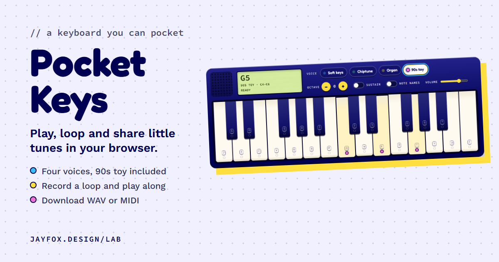

# Pocket Keys

A musical keyboard toy in the browser. Tap, slide or type to play; switch between a
recorded grand piano and synthesized voices; record a loop and play along; download it as WAV or MIDI to use in a
project, or share it as a link. Free, no sign-up.



## What it does

- **Two octaves** on wider screens, one on phones held upright. Multi-touch chords, and slide
  a finger across the keys to play each one in turn.
- **Computer keyboard:** `Z` to `/` play the lower octave (the row above is the black keys),
  `Q` to `I` the upper octave (the number row is the black keys). Hold `Shift` for sustain;
  `-` and `=` change octave. Or Tab to the keys, arrow between them and press Enter.
- **Voices:** a grand piano made from real recordings (the Salamander Grand Piano, CC BY 3.0),
  plus soft keys, chiptune, organ and a wobbly 90s toy, synthesized with Web Audio.
- **Sustain works like a piano's damper pedal:** keys pop back up when you let go, and the
  sound keeps ringing until you lift the pedal (Shift, or the Sustain switch).
- **Octave, sustain, note names, volume.** Voice, volume and note names are remembered.
- **Loop:** record up to 30 seconds, then play it on repeat and play along.
- **Save:** each option says what you get before you click, and the page names the file once
  it's saved. **Sound (.wav)** is a recording of what you heard; **Seamless loop (.wav)** is
  exactly one loop with the ringing tail folded back to the start, so it repeats with no gap
  (like a GIF for sound); **Notes (.mid)** is for GarageBand, Logic, Ableton or MuseScore.
  Sound and notes can repeat the loop 1, 2 or 4 times. What you make is yours to use.
- **Share:** copy a link with the tune packed into it; whoever opens it can play it.

## How it's built

React 18 + Vite + TypeScript (strict). Logic lives in `src/engine` with no React or audio:

- `notes.ts`: MIDI note numbers, frequencies, names.
- `keymap.ts`: physical computer keys to notes (`KeyboardEvent.code`, any keyboard language).
- `tune.ts`: recording, looping windows and the share-link format.
- `files.ts`: WAV (16-bit PCM) and MIDI (Standard MIDI File, format 0) writers.

Sound lives in `src/audio`: `synth.ts` (the four voices), `player.ts` (loop playback scheduled
on the audio clock) and `render.ts` (offline rendering for WAV downloads).

Why things are the way they are: **[DECISIONS.md](DECISIONS.md)**.

## Run it

Needs Node 18.18+.

```sh
npm install
npm run dev        # http://localhost:5173
npm run check      # types, lint, format, unit tests, build
npm run test:e2e   # Playwright, desktop Chrome + Pixel 7 (build first: npm run build)
```

## Tested

- **Unit (Vitest, 25):** note math and names; the keyboard layout (every letter lands on the
  right color of key); recording, time limits and loop windows (every note scheduled exactly
  once); share links round-trip and malformed links are rejected; WAV header and samples; MIDI
  structure, instrument, note order and repeats.
- **Browser (Playwright, desktop Chrome and emulated Pixel 7):** keys play and light while
  held (sound confirmed by counting started oscillators and piano recordings); sliding plays each key; computer-key
  chords, Shift sustain (the key pops up, sound keeps going) and octave change; record, loop
  playback, sound, seamless-loop and notes downloads (the WAV is checked to be a real, non-silent
  file, the loop file carries its loop marker, and the page names each saved file); Tab and Enter; shared links open; no sideways scroll.
- **Not tested:** whether every app honors the seamless loop's marker (a video editor's own
  repeat setting always works); real phones, Safari, Firefox, a screen reader by hand, latency on real
  devices.

## License

Code: [MIT](LICENSE) © 2026 Jay Fox.

Grand piano recordings in `public/samples/piano`: the
[Salamander Grand Piano](https://freepats.zenvoid.org/Piano/acoustic-grand-piano.html) by
Alexander Holm, [CC BY 3.0](https://creativecommons.org/licenses/by/3.0/) (MP3s from the
Tone.js audio mirror). Credited on the page too.
